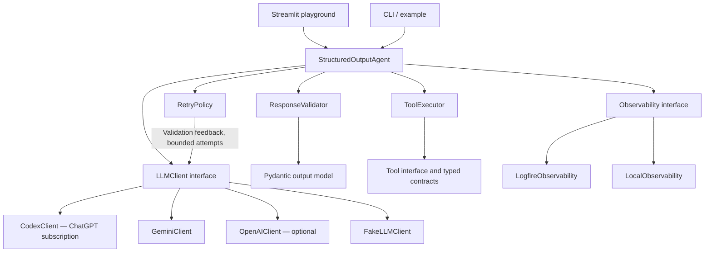

# Structured Output Agent

A Python project for turning LLM responses into validated, typed results using Pydantic, bounded retries, and observable failure handling.

**Status:** Steps 1–7 complete: contracts, validation, orchestration, typed tools, Codex, Gemini, and OpenAI adapters, local JSONL observability, and Logfire integration. Provider tests use mocked HTTP; Logfire tests use in-memory exporters. Gemini authentication and model listing have been verified; generation verification is described in the Gemini section below. OpenAI live access and remote Logfire delivery remain unverified. The Streamlit playground is implemented and browser-verified; broader evaluation remains next.

## Problem and purpose

LLM output can contain malformed JSON, missing fields, invalid values, or unusable tool responses. Applications need predictable contracts and explicit failure handling before consuming that output.

This project demonstrates how to enforce those contracts, recover from repairable errors, and measure reliability. Schema validity does not guarantee factual accuracy; domain checks and evaluation are separate concerns.

## First use case

Classify a support ticket into a typed result:

```json
{
  "category": "billing",
  "priority": "high",
  "summary": "Customer reports a duplicate charge",
  "requires_human": true
}
```

The initial schema will define allowed categories and priorities, required fields, summary length limits, strict types, and rejection of unexpected fields. A sample tool will retrieve synthetic ticket context with independently validated input and output models.

## Planned features

- Reusable agent accepting a Pydantic output model.
- Explicit JSON parsing and strict schema validation.
- Bounded retries with concise validation feedback.
- Independent validation of tool inputs and outputs.
- Typed success and controlled failure results.
- Streamlit playground with raw output, validated JSON, and attempt history.
- Deterministic fake-client scenarios for malformed JSON, missing fields, incorrect types, invalid tool output, recovery, and retry exhaustion.
- Logfire traces and validation telemetry with local structured logging as a fallback.
- Run identifiers connecting model calls, tools, validation, and retries.
- Automated tests without live API calls.

## OOP architecture

Use composition and dependency injection. The core agent receives a client, validator, retry policy, tool executor, and observability adapter. Interfaces are reserved for interchangeable dependencies; schemas are Pydantic models, not service classes.



### Class responsibilities

| Class / model | Responsibility |
| --- | --- |
| `StructuredOutputAgent` | Orchestrate one run, collect attempt records, and return a typed result; no UI or provider-specific code. |
| `LLMClient` | Define the model-generation interface and normalize provider responses. |
| `CodexClient` | ChatGPT-authenticated Codex adapter; schema-constrained actions with application-owned tool execution. |
| `GeminiClient` | Google GenAI adapter; structured outputs and signed tool continuations. |
| `OpenAIClient` | Optional Responses API adapter behind the same interface. |
| `FakeLLMClient` | Return scripted responses for deterministic tests and failure simulation. |
| `ResponseValidator` | Parse JSON and validate against the supplied Pydantic model; normalize useful validation errors. |
| `RetryPolicy` | Decide whether an error is retryable and whether the attempt budget remains; build repair feedback. |
| `Tool` | Define a tool name, execution contract, and Pydantic input/output models. |
| `ToolExecutor` | Validate arguments, invoke a registered tool, validate its response, and report failures. |
| `Observability` | Define run/attempt spans, events, metrics, and correlation without coupling the agent to a vendor. |
| `LogfireObservability` | Export traces and events to Logfire, including validation failures. |
| `LocalObservability` | Record structured local events when remote telemetry is disabled. |
| `AgentConfig` | Validate runtime settings, retry limits, model configuration, and telemetry options. |
| `AttemptRecord` | Describe an attempt, timing, outcome, and sanitized error details. |
| `AgentResult` | Represent validated success or explicit terminal failure with attempt history. |
| `SupportTicket` | Define the initial domain output schema. |

### Execution and failure handling

1. Validate configuration and input; assign a run ID.
2. Request a response through `LLMClient`.
3. If a tool is requested, validate its arguments and output before using the result.
4. Parse the final response and validate it against the requested model.
5. On a repairable error, record diagnostics and request a correction within the attempt budget.
6. Return a validated object on success, or a typed terminal failure after exhaustion.

`max_attempts` includes the first final-response validation attempt. A value of 3 permits at most three such attempts. Each attempt can include tool continuations, bounded across the run by `max_tool_calls`. Total model calls are bounded by `max_attempts + max_tool_calls` (including a call whose tool request is rejected at the limit). Side-effecting tools must not be blindly replayed. Authentication/configuration failures are terminal; transport retry behavior is separate from schema-repair retries.

## Streamlit testing playground

The implemented UI accepts ticket text, a scenario, and the maximum attempts. It shows raw and validated output, a per-attempt timeline, validation errors, final status, and elapsed time. Fake mode will run without API credentials. Live mode will use environment configuration.

The UI is a thin presentation layer calling the same application services as the CLI. No validation or retry logic belongs in Streamlit callbacks.

## Observability with Logfire

Each run will contain spans for model generation, tool execution, parsing, validation, and retry decisions. Local and remote adapters will share the same event contract.

Planned metrics:

- First-attempt success rate: runs succeeding on attempt one / all runs.
- Recovery rate: initially invalid runs that eventually succeed / initially invalid runs.
- Final failure rate: failed runs / all runs.
- Attempts per run and end-to-end latency.
- Validation failures grouped by schema, field, error type, and tool.

Handle empty denominators explicitly. Report fake scenarios separately from live-model evaluations. Prompts, raw responses, customer data, credentials, and tool payloads are excluded from telemetry by default; sanitized error metadata is sufficient for initial diagnostics.

## Project layout

```text
structured-output-agent/
├── README.md
├── pyproject.toml
├── .env.example
├── .gitignore
├── .venv/                       # Local isolated environment; ignored
├── src/structured_output_agent/
│   ├── agent.py
│   ├── config.py
│   ├── exceptions.py
│   ├── clients/                 # Provider interface, adapter, fake client
│   ├── schemas/                 # Domain and run-result models
│   ├── validation/              # JSON parsing and Pydantic validation
│   ├── retry/                   # Bounded retry decisions and feedback
│   ├── tools/                   # Tool contracts, registry/executor, sample
│   └── observability/           # Interface, Logfire and local adapters
├── ui/app.py                    # Planned Streamlit entry point
├── examples/classify_ticket.py
└── tests/                       # Validation, retries, tools, telemetry contracts
```

## Environment and installation

Python 3.11 or newer is the intended baseline. The local virtual environment uses Python 3.13.1. Pydantic 2.14.1, pydantic-settings 2.16.0, and pytest 9.1.1 are installed in the local `.venv` and tested on Python 3.13.1. Other supported Python versions have not been tested yet.

```bash
cd /Users/shreyanshjain/shreyansh/structured-output-agent
source .venv/bin/activate
python -m pip --version
```

Always install libraries through this environment's `python -m pip`. Do not install project dependencies globally. To recreate the environment, run `python3 -m venv .venv` from the project folder.

Current runtime dependencies: Pydantic, pydantic-settings, Google GenAI 2.x (tested with 2.31.0), OpenAI SDK 2.x (tested with 2.54.0), and Logfire 4.x. Development dependency: pytest. Logfire 4.x is installed (tested with 4.41.0); Streamlit is installed (tested with 1.66.0). All installation uses the local `.venv`.

`AgentConfig` loads `.env` from the working directory, with environment variables taking precedence. Empty environment values are ignored. Fake mode is the default. Live mode defaults to Gemini and requires `GEMINI_API_KEY` when selecting Gemini; `LLM_PROVIDER=codex` uses local ChatGPT sign-in; `LLM_PROVIDER=openai` instead requires `OPENAI_API_KEY` and `OPENAI_MODEL`; the Logfire backend requires `LOGFIRE_TOKEN`. Secret fields use `SecretStr`. Keep `.env` untracked. `max_attempts` is bounded to 1–10 and `max_tool_calls` to 0–20. Direct settings construction intentionally permits environment-style conversion; output contracts are strict.

Install the current package and run its contract tests:

```bash
python -m pip install -e '.[dev]'
python -m pytest
```

Start the implemented playground with `python -m streamlit run ui/app.py` from the project directory.

## Step-by-step implementation plan

1. **Contracts — complete:** configuration, ticket schema, result models, and exception categories; 28 tests pass.
2. **Validation — complete:** reusable parser and strict validator; full suite now has 63 passing tests.
3. **Recovery — complete:** fake client, retry policy, and orchestrator; the full suite has 90 passing tests covering recovery, terminal errors, exhaustion, and isolated run state.
4. **Tools — complete:** typed contracts, registered executor, synthetic context tool, and bounded agent integration; full suite: 117 tests.
5. **Live provider — complete:** Responses API adapter, strict schemas, tool continuations, sanitized errors, and opt-in live example. Full suite: 136 tests; no paid requests made.
6. **Observability — complete:** local JSONL and Logfire adapters, correlated spans, sanitized events, counters/histograms, configuration wiring, and offline demo. Full suite: 146 tests.
7. **Playground — complete:** offline/live controls, validation diagnostics, retries, raw-response capture, trace timeline, bounded history, and separated session metrics. Full suite: 196 tests, including Streamlit AppTest coverage.
8. **Evaluation and documentation:** run a fixed scenario set, publish measured results with sample sizes, and add demo instructions.

## Expected outcomes and acceptance criteria

- Downstream callers receive a validated object or a documented failure result.
- Invalid JSON and schema violations yield actionable error records.
- Recoverable failures can succeed within a finite, observable retry budget.
- Invalid tool output is blocked before downstream consumption.
- Deterministic tests prove both success and failure behavior without API costs.
- The UI makes each attempt and correction inspectable.
- Reliability metrics show measured behavior rather than claiming perfect model accuracy.

No reliability figures are claimed yet. This is a portfolio demonstration of contract enforcement, testable OOP design, recovery, and observability; production use would require additional security, concurrency, persistence, and operational work appropriate to its deployment.

## Implemented contracts

`SupportTicket` permits billing/technical/account/general categories, low/medium/high priorities, a nonblank summary of at most 500 characters, and a strict boolean. Unknown keys and implicit type coercion are rejected. Contract instances are frozen; nested attempt history uses tuples.

`AgentResult[SupportTicket]` requires data and a successful final attempt on success. Failure requires an error and no data; preflight failures may have no attempts. Attempts are numbered contiguously from one and stop after success. Durations must be finite and nonnegative. `FailureDetail` contains a bounded diagnostic message and error category; producers must sanitize messages before storing them.

```python
from structured_output_agent.config import AgentConfig
from structured_output_agent.schemas import SupportTicket

config = AgentConfig()  # Reads .env relative to the current working directory.
ticket = SupportTicket.model_validate_json(
    '{"category":"billing","priority":"high",'
    '"summary":"Duplicate charge","requires_human":true}'
)
print(ticket.model_dump())
```

Validation checks include invalid enums/types, missing and extra fields, summary bounds, dotenv precedence, credential requirements, secret masking, result consistency, JSON round trips, and invalid durations. No live model or remote telemetry is used in these tests.

## ResponseValidator usage

```python
from structured_output_agent.validation import ResponseValidator
from structured_output_agent.schemas import SupportTicket
from structured_output_agent.exceptions import ResponseParseError, SchemaValidationError

validator = ResponseValidator(max_response_chars=1_000_000, max_json_depth=100)
response = '{"category":"billing","priority":"high","summary":"Duplicate charge","requires_human":true}'
try:
    ticket = validator.validate(response, SupportTicket)
except ResponseParseError as error:
    print(str(error), error.line, error.column)
except SchemaValidationError as error:
    for issue in error.issues:
        print(issue.location, issue.code)
```

`parse_json(text)` parses a single complete JSON value. `validate(text, Model)` additionally returns an instance of the supplied Pydantic model, using strict JSON validation. This preserves JSON representations for dates and UUIDs while rejecting inappropriate scalar coercion. The schema controls extra-field handling; inherit `StrictModel` to reject unexpected fields.

Malformed/trailing JSON, markdown fences, duplicate keys (including nested objects), NaN/Infinity constants, oversized responses, and excessive nesting raise `ResponseParseError`. Valid JSON of the wrong shape or with invalid fields raises `SchemaValidationError`. The service does not strip prose or silently repair responses; recovery belongs to the next implementation step.

Schema issues contain error codes and declared top-level field names; unknown or nested string locations are replaced with `<field>`. Messages, input values, and Pydantic context are excluded. Exceptions have no chained parser/Pydantic exception context. These measures sanitize exception details, not caller source code or traceback locals: observability adapters must never capture locals or raw response payloads. Programmer errors (non-string input or a non-Pydantic output model) raise `TypeError`.

The depth check runs after parsing; parser recursion failures are also converted to parse errors. Character and depth limits bound accepted responses but are not a replacement for process-level resource limits on hostile inputs. The validator itself performs no LLM calls or retries; the orchestration service below coordinates offline retries. Remote telemetry is available through the explicit Logfire adapter below.

## Offline agent and retry demo

From the project directory with `.venv` activated:

```bash
python examples/classify_ticket.py
python -m pytest -q
```

The demo scripts an invalid `urgent` priority followed by a valid `high` priority. It prints a typed success result with two attempt records. This demonstrates control flow, not real-model reliability: the fake client returns scripted values and does not reason about feedback.

```python
from structured_output_agent.agent import StructuredOutputAgent
from structured_output_agent.clients import FakeLLMClient
from structured_output_agent.config import AgentConfig
from structured_output_agent.retry import RetryPolicy
from structured_output_agent.schemas import SupportTicket

config = AgentConfig()
client = FakeLLMClient([
    'not JSON',
    '{"category":"billing","priority":"high","summary":"Duplicate charge","requires_human":true}',
])
agent = StructuredOutputAgent(client, retry_policy=RetryPolicy(config.max_attempts))
result = agent.run("I was charged twice", SupportTicket)
print(result.model_dump_json(indent=2))
```

### Implemented orchestration contracts

- `LLMClient.generate(GenerationRequest)` returns response text or one `ToolCall`, or raises `ProviderError`. Requests carry the original prompt, JSON schema, attempt number, and optional repair feedback. Provider-specific settings belong in provider adapters.
- `FakeLLMClient` consumes one scripted string, `ToolCall`, or `ProviderError` per call. Exhausting the script produces a controlled provider failure; responses never cycle. Use a fresh instance per independent scenario. Its captured request history is for local inspection and contains user data; never export it as telemetry. It is a sequential test client, not a concurrent client.
- `RetryPolicy` permits 1–10 final-response validation attempts, including the first. Tool continuations have a separate finite budget. It retries only JSON/schema errors within that budget. Feedback includes sanitized schema issue locations and codes (at most ten), or generic parsing guidance; raw failed responses are not resent. The request always includes the target JSON schema.
- `StructuredOutputAgent.run(prompt, OutputModel)` requires a nonblank string and a `StrictModel` subclass. It returns `AgentResult[OutputModel]`, assigns a unique run ID, and records attempt/run durations. Each run starts with fresh feedback and attempt state.
- Successful validation ends the run immediately. Repair exhaustion returns `retry_exhausted`, retaining the last validation category in the attempt record. `FailureDetail.retryable` describes the failure category; policy and remaining budget determine whether another call actually occurs.
- Provider errors are terminal and expose only a generic message. Unexpected programming exceptions propagate. Invalid caller inputs raise before any client call. Transport retries, timeouts, cancellation, and automatic provider instrumentation remain unimplemented; explicit observability is described below. Validated tool execution is described below.

No new dependencies were needed for step 3. Tests and the demo run entirely inside the existing `.venv`, without credentials or live model calls.

## Typed tools and validated execution

```bash
python examples/tool_ticket.py
```

`Tool[InputModel, OutputModel]` declares a name, description, strict Pydantic input/output models, and `execute(arguments)`. `ToolExecutor` builds a registry, rejects duplicate names, exposes JSON schema definitions, validates arguments before execution, and independently validates outputs before serializing them for the model. Unknown tools, runtime failures, and invalid tool data become sanitized terminal failures. Tool implementations must treat their declared schemas as trusted application code.

`TicketContextTool` is read-only and uses synthetic records for `TICKET-001` and `TICKET-002`. It has no external dependencies or customer data. The fake demo scripts a tool call followed by a final ticket classification; it does not prove that an LLM inferred the classification from the tool response.

`GenerationRequest.tools` advertises registered tool schemas; `tool_results` contains only successfully validated results, preserved within a run across final-response repair attempts. The current protocol permits one synchronous tool call per response, with ordered results; parallel tool calls remain unsupported. Optional call IDs and serialized provider items carry Responses API continuation context without retaining adapter-level conversation state.

`StructuredOutputAgent(..., tool_executor=executor, max_tool_calls=5)` accepts a run-wide budget of 0–20 calls. A zero budget disables execution. A rejected over-budget request is not counted as an executed call. `AgentResult.tool_calls` counts calls submitted for execution, including those rejected by tool validation or registry lookup. Final-response attempts and tool execution budgets reset for each run. To use environment configuration, pass `max_tool_calls=config.max_tool_calls` when constructing the agent.

A tool continuation stays within its current final-response attempt. At most `max_attempts + max_tool_calls` model calls occur. Tool errors terminate with `tool_validation_error` or `tool_execution_error`; requesting another tool after the budget terminates with `tool_limit_exceeded`. Successfully executed tools are not automatically replayed when final output fails validation. If a model explicitly requests the same tool again, it is a new execution counted against the budget. Only the read-only synthetic tool is supplied; side-effecting tools would need deduplication/idempotency before use.

Attempt history stores sanitized failure categories, and the result reports the call count. Detailed tool spans and local event persistence are implemented in the observability step below. The executor does not log payloads. Tool payloads and captured fake-client requests remain sensitive in-memory application data.

Tests cover registry contracts, strict arguments, invalid/malformed outputs, constructed invalid model instances, sanitized execution failures, context propagation, no automatic replay, tool limits, and isolated run state. No new dependencies were installed for this step.

## OpenAI live provider

`OpenAIClient` implements `LLMClient` with the Responses API. It requests strict structured output, then returns text to the existing local validator. Strict function definitions advertise tools; validated tool outputs are paired with provider call IDs. Reasoning items (including encrypted continuation content) are carried in per-run requests for stateless replay with `store=False`. These in-memory provider items are not telemetry and must not be logged.

The adapter disables parallel tool calls and SDK transport retries, applies a per-request timeout and output-token limit, and treats API errors, refusals, empty responses, and incomplete responses as sanitized terminal `ProviderError`s. Local schema/JSON errors still use the existing repair policy. Provider failures do not consume hidden SDK retry attempts. The timeout is per request, not a deadline for the entire agent run or local tool execution.

Strict provider schemas require all object properties; the adapter removes defaults and marks declared properties required while forbidding extra properties. Nullable fields remain nullable. This means a field with a local default must still be supplied by the provider. Not all Pydantic JSON schemas or models are supported by OpenAI; unsupported requests fail without silently falling back to unconstrained output. Custom validators still execute locally.

### Opt-in live run

Activate `.venv`, copy `.env.example` to `.env`, and set:

```dotenv
AGENT_MODE=live
LLM_PROVIDER=openai
OPENAI_API_KEY=your-key
OPENAI_MODEL=your-supported-model-id
OPENAI_TIMEOUT_SECONDS=30
OPENAI_MAX_OUTPUT_TOKENS=2000
OBSERVABILITY_BACKEND=local
```

Choose a model available to your account that supports Responses API structured outputs and function calling. Keep `.env` untracked. This example sends ticket text and synthetic tool context to OpenAI and incurs normal API usage charges:

```bash
python examples/live_ticket.py
```

`OpenAIClient.from_config(config)` builds the adapter without making an API request. Use it as a context manager to close its owned SDK client. Tests can inject an SDK client, whose lifecycle remains the caller's responsibility. Fake examples are unchanged and require no API credentials.

The automated provider tests use `httpx.MockTransport` with the real SDK; they verify request serialization, call IDs/reasoning replay, local validation and repair, run isolation, and terminal error handling. They do not establish live credentials, model access, billing, or provider schema acceptance. All 136 tests pass without live API calls.

Implementation references: [OpenAI structured outputs](https://developers.openai.com/api/docs/guides/structured-outputs?api-mode=responses) and [OpenAI function calling](https://developers.openai.com/api/docs/guides/function-calling).

## Local and Logfire observability

`Observability` defines payload-free events, correlated spans, and flushing. `LocalObservability` appends one JSON object per event to a file or caller-provided stream. `LogfireObservability` creates manual spans, structured events, and counters/histograms. `create_observability(config)` explicitly selects a backend; importing modules never configures telemetry or starts remote export.

### Try local logging without LLM API calls

With `.venv` activated, set these values in `.env` (defaults shown):

```dotenv
AGENT_MODE=fake
OBSERVABILITY_BACKEND=local
OBSERVABILITY_LOG_PATH=logs/events.jsonl
```

```bash
python examples/observe_ticket.py
```

This runs six scripted scenarios: first-attempt success, recovery, exhaustion, provider failure, validated tool success, and invalid tool arguments. It prints run IDs and appends JSONL to the configured file, which is ignored by Git. Local timestamps are UTC ISO timestamps. The demo deliberately uses a three-attempt budget for comparable scenarios. It makes no model API calls.

### Send the same demo to Logfire

Create a Logfire project and obtain its write token. Set:

```dotenv
AGENT_MODE=fake
OBSERVABILITY_BACKEND=logfire
LOGFIRE_TOKEN=your-project-write-token
```

Run `python examples/observe_ticket.py`, then inspect your project's Live view and Metrics explorer. This sends sanitized telemetry remotely but still makes no LLM API calls. The live-provider example also honors this backend selection. Local logs and remote export are alternative adapters, not a simultaneous fan-out configuration. Remote credentials and delivery have not been tested in this workspace.

### Instrumentation and metrics

Inject `observability=observer` into `StructuredOutputAgent`, and call `observer.close()` in a `finally` block at application shutdown. Agents default to `NoOpObservability` so existing tests and examples remain quiet unless telemetry is explicitly supplied. The live example and observability demo use the configuration factory. File ownership and startup configuration failures are explicit errors; runtime backend failures are fail-open and counted in `observer.telemetry_failures`. They do not change the agent result.

Recorded spans cover the run, model generation, combined final JSON parsing/schema validation, tool input validation, invocation, and output validation. Events include validation failures/issues, retry scheduling, attempt failures, and terminal run summaries. Span IDs and parent IDs provide local correlation; Logfire also creates native trace relationships. Run spans carry the terminal result status even when a controlled failure is returned normally. Unexpected exceptions are marked `internal_error` and re-raised without recording their messages.

Logfire metrics:

| Metric | Meaning |
| --- | --- |
| `agent.runs` | Completed typed outcomes, tagged with status, mode, provider, schema, first-attempt success, initial validation failure, and recovery |
| `agent.validation_failures` | Final-response and tool-validation failures by stage/category; tool names come only from the trusted registry |
| `agent.run.duration` | End-to-end run duration histogram in milliseconds |
| `agent.run.attempts` | Final-response validation attempts per completed run |

Calculate first-attempt success and final failure rates over completed runs. Calculate recovery rate over runs with `initial_validation_failure=true`; filter the numerator to `recovered=true`. Empty denominators have no defined rate. Always filter/group by `mode` to separate scripted fake runs from live runs. Caller/programming exceptions emit failed spans but not `run.completed` or completed-run metrics. IDs are excluded from metric dimensions to avoid per-run cardinality. Local `run.completed` JSONL records contain the same summary fields, allowing local analysis without Logfire. Detailed final-validation issue events include sanitized field names and issue codes; they are not separate failure counts.

### Privacy and operational limits

Only explicit metadata is recorded: IDs, trusted schema/tool names, attempt counts, timing, statuses, and error categories. Prompts, raw outputs, tool arguments/results, credentials, provider continuation items, repair feedback, and exception messages/locals are excluded. No automatic Pydantic or OpenAI instrumentation is enabled, since it could capture payloads. Backend spans are exited without passing exception objects. Keep schema/tool metadata free of customer information. The allowlist drops unexpected attributes; it is not a scrubber for sensitive values deliberately placed in allowed fields.

Logfire uses an isolated SDK configuration with argument inspection disabled. Initialization explicitly enables remote export only for the Logfire backend. Export is asynchronous; `close()` flushes it but does not guarantee delivery during network or backend outages. The backend failure counter tracks synchronous adapter failures, not every asynchronous exporter error. Local files append without rotation; rotation, retention, dashboards, alerts, and deployment monitoring remain future work.

Tests exercise real Logfire SDK spans and metrics with `send_to_logfire=False` and in-memory exporters, plus local file/stream logging, correlation, sanitization, recovery, tool stages, context reset, and backend failure isolation. No real write token or remote export is required.

Reference: [Logfire configuration and SDK APIs](https://pydantic.dev/docs/logfire/api/logfire/).

## Gemini provider

Select Gemini with `LLM_PROVIDER=gemini`. The local configuration now selects Codex; the OpenAI adapter remains optional. `create_live_client(config)` chooses the provider, and `examples/live_ticket.py` uses that factory. Both providers share local validation, retries, typed tools, and observability; metrics include a provider label to keep their results separate.

```dotenv
AGENT_MODE=live
LLM_PROVIDER=gemini
GEMINI_API_KEY=your-key
GEMINI_MODEL=gemini-3.8-flash
GEMINI_TIMEOUT_SECONDS=30
GEMINI_MAX_OUTPUT_TOKENS=4096
OBSERVABILITY_BACKEND=local
```

```bash
python examples/live_ticket.py
```

The provided credential is saved only in the ignored local `.env`, with owner-only file permissions. `.env.example` contains placeholders. Do not copy a real credential into code, logs, or this README. `GEMINI_API_KEY` uses Pydantic `SecretStr`; it is passed explicitly to the Google SDK so another ambient key does not silently override the configured one.

`GeminiClient` uses the Google GenAI SDK's Generate Content API. It supplies the JSON schema and JSON MIME type, then returns text to the local `ResponseValidator`. Tool declarations use JSON schemas, and SDK automatic function calling is disabled so all execution passes through `ToolExecutor`. At most one function call per model response is supported; parallel responses terminate as provider errors. Full model content, opaque thought signatures, function-call IDs when present, and validated tool responses are replayed from per-run request data. They are excluded from telemetry. The adapter has no shared conversation state.

The SDK has a one-request transport budget (automatic retries disabled), a per-request timeout, and an output-token limit. Blocked, empty, incomplete, and parallel-call responses are terminal; API/transport exceptions are sanitized without chaining raw errors. API rejection of unsupported schemas or models never causes a silent switch to unconstrained output.

`gemini-3.8-flash` is the initial configurable choice because the current documentation lists structured outputs and tools together for the Gemini 3 series. This combined feature is marked preview. Changing `GEMINI_MODEL` requires checking support for both features, account access, and limits. Local schema validation remains authoritative.

Provider tests use the real Google SDK with mocked HTTP, including structured request serialization, signed tool replay, local schema repair, run isolation, blocked/empty responses, API errors, and timeout behavior. The suite has 170 passing tests. Test results do not establish remote model availability; live smoke-test results are recorded separately.

References: [Gemini structured outputs](https://ai.google.dev/gemini-api/docs/generate-content/structured-output), [function calling](https://ai.google.dev/gemini-api/docs/function-calling), and [API key setup](https://ai.google.dev/gemini-api/docs/api-key).

### Gemini live verification

The configured credential successfully authenticated a model-list request, and `gemini-3.8-flash` was listed as available. Two structured-output generation checks returned HTTP 504, including one with a longer timeout. A diagnostic request using the separately listed `gemini-3.5-flash` returned HTTP 503; the configured model was left unchanged. Authentication/model discovery therefore work, but successful live generation is not established. The adapter reports this as a sanitized provider failure without attempting hidden retries. Automated tests remain offline and passing.

## Streamlit testing playground

From the project directory:

```bash
source .venv/bin/activate
python -m streamlit run ui/app.py
```

Open [the local playground](http://127.0.0.1:8501). The development server binds to `127.0.0.1`; it is not a public deployment. Anonymous Streamlit usage statistics are disabled in the project configuration.

### Test the full flow

1. Start in **Offline demo** (the UI default, even when `.env` selects live mode).
2. Choose **Malformed JSON → recovery** or **Schema error → recovery**, keep the validation budget at 3, and click **Run agent**.
3. Inspect the validated ticket in **Result**. In **Validation & retries**, inspect failed attempts, sanitized field/error codes, JSON line/column diagnostics, and repair guidance sent on the next attempt.
4. Inspect **Model responses** to compare raw responses with the final result, if session capture was enabled.
5. Open **Observability** for the correlated event timeline, completed-span timings, full sanitized trace, and JSONL download. The selected backend also receives those events.
6. Try **Retry exhaustion**, **Invalid tool arguments**, **Invalid tool output**, **Tool call limit**, and **Provider failure** to verify controlled failure behavior. **Custom JSON → recovery** accepts your own first response and follows it with a valid scripted ticket if budget remains.

Offline replies are deterministic scripts; changing the support message does not change their content. Tool scenarios execute the actual typed tool boundary. The invalid-output scenario deliberately supplies an incorrect synthetic output to demonstrate its rejection.

Switch to **Live Gemini** to use `.env` credentials and the selected model. Raw capture is off by default for live mode. API calls happen only on **Run agent**; widget changes, timeline filters, history selection, and downloads never run the agent again. Live schema/tool support and service availability still depend on Gemini; previous live generation smoke tests returned 503/504 despite successful model discovery.

### Observability and session data

- **Local JSONL** is the default UI backend. Relative log paths are resolved against the project root, and telemetry is also retained in the current report for inspection.
- **Logfire** uses `LOGFIRE_TOKEN` from `.env` and sends the same sanitized events plus native spans and metrics. The in-app timeline is local evidence of instrumentation, not proof of remote delivery. The UI links to Logfire and displays the run ID for filtering there.
- History retains only the latest 10 completed runs in the current browser session. **Clear session history** removes these reports, including captured raw text, but does not delete local logs, downloaded files, or remotely exported telemetry.
- Session rates separate offline and live runs. Recovery uses initially invalid runs as its denominator. A dash means no applicable sample. Session history is not a durable evaluation dataset or a substitute for production monitoring.
- Raw capture stores at most 5,000 characters per model response in memory and marks truncation; the agent validates the full response. Raw text is never added to local/Logfire telemetry or the sanitized event download. The result download contains the validated ticket and can therefore contain information derived from the input.
- The event view retains at most 2,000 sanitized records per run and reports dropped events. Provider/SDK/config objects and credentials are not stored in report history. Rendering errors never show raw exception tracebacks in the UI.
- Agent runs are synchronous; the UI shows a spinner until completion. Streaming progress, cancellation, durable history, authentication, and multi-user deployment controls are not implemented.

### OOP application boundary

| Class | Responsibility |
| --- | --- |
| `PlaygroundRunner` | Build a per-run client, typed tools, retry policy, and configured observability; execute the same agent services as the CLI and close resources. |
| `RecordingClient` | Decorate any client with bounded, optional in-session raw-response capture and call metadata; preserve provider/mode labels. |
| `PlaygroundReport` | Hold the completed result, sanitized events, call diagnostics, and non-secret run settings. |
| `MemoryObservability` | Collect bounded sanitized telemetry and mirror events/native spans to the configured backend without creating duplicate agent runs. |

`ui/app.py` handles widgets and rendering. Parsing, validation, retry decisions, provider calls, and tool execution stay in their existing services. A small client metadata contract (`execution_mode`, `provider_name`) keeps wrapped clients correctly classified without provider-specific logic in the agent.

### Verification

The full suite has **196 passing tests**. Streamlit AppTest exercises initial offline startup, recovery, no re-execution on reruns/filters, exhaustion, invalid tool output, missing live credentials/Logfire token, custom JSON, and clearing history. Service tests cover every offline scenario, raw-capture bounds and telemetry separation, session metrics, backend failures, and a mocked live run. The running local page was also checked in the browser. No live Gemini or remote Logfire requests were made for UI verification.

## VS Code breakpoints and debugging

Open **the `structured-output-agent` project folder itself** in VS Code so `${workspaceFolder}` points to this project. Install the recommended Microsoft **Python** and **Python Debugger** extensions when prompted. The workspace selects the existing `.venv`; no global library installation is needed. VS Code's debugger extension supplies debugpy, so the project does not need an additional debugpy dependency.

### Debug the Streamlit UI

1. Set a breakpoint in `ui/app.py`, `playground.py`, `agent.py`, `validation/response_validator.py`, or `tools/executor.py` by clicking the editor gutter.
2. Open **Run and Debug**, choose **Streamlit: playground (debug port 8502)**, and press **F5** (or use **Run → Start Debugging**).
3. Open [the debug playground](http://127.0.0.1:8502). This is a separate process from the existing non-debug server on port 8501.
4. Start in **Offline demo** and click **Run agent**. The debugger will pause when that request reaches your breakpoint. Controls that only rerender the page will not reach agent-execution breakpoints.
5. Use **F10** to step over, **F11** to step into, **Shift+F11** to step out, and **F5** to continue (or use the debug toolbar). On some Mac keyboards, hold **Fn** for function keys.

The Streamlit launch uses `python -m streamlit`, the project's `.venv`, and the project root as its working directory. File watching and automatic reruns are disabled for a predictable debug session; restart debugging after code changes. `justMyCode=true` steps through application code. Set it to `false` if you need to step into Pydantic, provider SDKs, or Streamlit.

### Other launch profiles

| Profile | Use |
| --- | --- |
| CLI: classification and retries | Step through an offline schema failure and repair |
| CLI: validated tool execution | Step through typed tool input/output validation |
| CLI: local observability scenarios | Inspect local events and reliability scenarios without LLM calls |
| CLI: live Gemini (uses API quota) | Debug a real Gemini request using `.env` credentials |
| Pytest: all tests | Run the full suite under the debugger |
| Pytest: current test file | Debug the active Python test file |
| Pytest: Test Explorer debugging | Supply debugger settings for VS Code's test gutter/Test Explorer actions |

For a specific test, use **Debug Test** in the test gutter or Test Explorer. Useful breakpoints include `ResponseValidator.validate`, `RetryPolicy.should_retry`, `ToolExecutor._execute`, and the generation/validation loop in `StructuredOutputAgent._run`.

The UI and live CLI profiles load `.env`. Offline profiles and Test Explorer use `.env.example` plus fake/local overrides so tests don't inherit the live/Logfire settings in the local `.env`. Actual API keys are never copied into `.vscode` files. The UI still starts in offline mode; choose live mode explicitly to send API requests. Debugger variable views can inspect in-memory secrets, so avoid sharing unredacted debug screenshots.

If a breakpoint is unbound, confirm that the project folder is open and **Python: Select Interpreter** points to `.venv/bin/python` (on Windows, `.venv/Scripts/python.exe`). If port 8502 is already occupied, stop the earlier debug session or change the port and matching browser URL in `launch.json`.

Configuration reference: [VS Code Python debugging](https://code.visualstudio.com/docs/python/debugging).

## Separate Codex SDK subscription smoke test

This experiment is isolated from the agent adapters and UI. It uses the official `openai-codex` Python SDK (pinned to 0.162.1) and its bundled CLI runtime. Install the optional extra inside the existing virtual environment:

```bash
source .venv/bin/activate
python -m pip install -e '.[codex-smoke]'
python examples/codex_sdk_smoke.py
```

The script does not load `.env`, overrides ambient OpenAI API-key values in its child process, and requires the SDK account check to report ChatGPT authentication before requesting inference. It never silently changes to API-key billing. It starts an ephemeral, read-only Codex thread in an empty scratch directory, requests one synthetic support-ticket classification with the output schema, and validates the final response using the existing strict `ResponseValidator`. Instructions prohibit file inspection, commands, browsing, and tool use. It does not expose the application's tool executor to Codex.

Optional arguments:

```bash
python examples/codex_sdk_smoke.py --timeout 90
python examples/codex_sdk_smoke.py --model your-account-supported-model-id
```

Without `--model`, Codex chooses its configured default. Subscription model availability and limits still apply. This is a Codex SDK experiment, not the standard OpenAI API-key client and not a completed application integration.

### Initial SDK experiment result in this workspace

- The SDK and pinned runtime installed successfully in `.venv`.
- The installed desktop CLI reports `Logged in using ChatGPT`.
- The SDK initially could not start because the sandbox blocked its normal `.codex` state database. After filesystem permission was granted, startup proceeded.
- Account checks using both the SDK-bundled runtime and the installed desktop runtime returned JSON-RPC error `-32603`: `workspace routing discovery failed`.
- The authentication gate therefore stopped the experiment before a model request. That initial check obtained no completed inference. A subsequent user-run smoke test completed successfully with ChatGPT authentication and strict Pydantic validation; the adapter integration is documented below. The script exits nonzero with a sanitized diagnostic.

A cached CLI login is not proof of working SDK inference. Verify account/workspace connectivity and, if necessary, sign in again with `codex login`, then rerun the script. Reauthentication is a possible diagnostic step, not a confirmed fix for the routing error. Credentials, auth files, and raw SDK errors are not printed or copied into source.

Reference: [Official Codex SDK documentation](https://learn.chatgpt.com/docs/codex-sdk).

## Integrated Codex provider and Live Codex playground

`CodexClient` now implements the same `LLMClient` interface as Gemini and OpenAI. The local `.env` selects `LLM_PROVIDER=codex`; Gemini credentials remain stored but are not used by this provider. Install the optional integration in the project virtual environment:

```bash
python -m pip install -e '.[dev,codex]'
codex login
codex login status
```

The SDK uses its pinned runtime, and the project-local `.venv/bin/codex` command links to that runtime in this checkout. If recreating `.venv` and the shell cannot find `codex`, use the pinned runtime installed by `codex_cli_bin` or install the official Codex CLI separately. The SDK does not require the shell command to be on PATH for inference; it finds its bundled runtime itself.

Configuration:

```dotenv
AGENT_MODE=live
LLM_PROVIDER=codex
CODEX_MODEL=
CODEX_TIMEOUT_SECONDS=90
CODEX_WORK_DIR=work/codex-agent
OBSERVABILITY_BACKEND=local
```

An empty `CODEX_MODEL` uses Codex's configured default, matching the successful standalone smoke test. An explicit model must be available to the signed-in account. No OpenAI API key is required. The adapter overrides ambient API keys, restricts the runtime to ChatGPT authentication, and checks the account mode before inference. Authentication failures terminate the run instead of switching billing methods.

Start or restart the UI, select **Live Codex**, leave the optional model blank, and click **Run agent**. The same validation/retry/result/observability tabs work with Codex. Offline mode remains the UI default. Session metrics now separate Offline, Live Codex, and Live Gemini; provider tags also identify remote telemetry. The **CLI: live Codex (ChatGPT subscription)** VS Code profile runs the existing live-ticket example. The Streamlit debug profile remains on port 8502.

### Codex tool protocol

This integration deliberately keeps the existing application agent in control. It does not register native SDK tool callbacks. With application tools enabled, the model emits a schema-constrained JSON action:

```json
{
  "kind": "tool",
  "output": null,
  "tool": {
    "name": "ticket_context",
    "arguments_json": "{\"ticket_id\":\"TICKET-001\"}"
  }
}
```

The adapter converts this to the existing `ToolCall`. The agent checks its run-wide tool budget, and `ToolExecutor` validates arguments, executes the registered tool, and validates output. The next generation receives the original message, tool definitions, validated results, and any repair feedback as explicit request data. Its final action contains `kind=final`, the ticket object in `output`, and `tool=null`. The adapter unwraps the object and returns JSON text to the existing strict validator. Tool argument JSON is always validated locally, regardless of provider schema enforcement.

Without tools, the SDK receives the final output schema directly. With tools, the action schema embeds that final schema and preserves its root definitions. Invalid action protocols are terminal provider errors; malformed JSON and invalid final outputs use the existing parse/schema repair flow. Unknown or invalid tools are rejected by the application's registry/validation boundary.

Each `generate()` starts and closes an ephemeral SDK thread in a temporary scratch directory. Validated context travels explicitly between calls; no SDK conversation or runtime process is cached across application runs. This adds startup overhead but avoids mixing browser-session histories. Commands and web search are disabled, the thread is read-only with approvals denied, and classifier instructions prohibit native tools and file inspection. Application tools execute in the host Python process through `ToolExecutor` and its existing limits. This is not a general-purpose Codex coding session.

`CODEX_TIMEOUT_SECONDS` bounds startup, authentication, and a single SDK turn; it is not a deadline for the entire multi-attempt application run. The existing synchronous interface uses an asyncio event loop internally; asynchronous callers should run it in a worker thread. Runtime errors/timeouts are sanitized as provider failures, and SDK processes close on success, failure, or cancellation. Local application telemetry excludes SDK payloads and credentials; Codex's own runtime state is separately managed by the installed Codex configuration.

The full automated suite currently has **221 passing tests** with the Codex extra installed. Tests mock the SDK transport/runtime boundary and cover subscription authentication gating, strict final validation, repair feedback, action decoding, validated tool continuation, tool limits, empty/failed turns, timeouts, SDK cleanup, nested schemas, and Live Codex UI behavior without network requests. Codex-specific adapter tests skip when its optional SDK dependency is absent.

References: [Codex SDK](https://learn.chatgpt.com/docs/codex-sdk) and [authentication](https://learn.chatgpt.com/docs/auth).

### Integration verification notes

The standalone subscription-authenticated smoke test completed successfully in the user's terminal and produced a valid ticket. A bounded live integration check from this Codex agent session instead encountered `workspace routing discovery failed` before generation. The application's own validation/tool integration is covered by mocked SDK and Streamlit tests; the full native action-envelope round trip still needs confirmation from the user's working terminal session. The UI now displays an allowlisted routing/authentication/timeout/runtime explanation for these known Codex failures without copying raw SDK errors.

Restart the Streamlit server from the same terminal where `codex_sdk_smoke.py` passed, select **Live Codex**, and leave the model blank to use the configured default. Select **Enable ticket context tool** to exercise the action envelope and existing tool executor. Run the live CLI example with `LLM_PROVIDER=codex` to exercise the same pipeline outside Streamlit.
